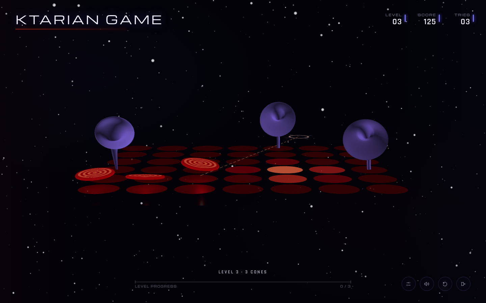

# Ktarian Game

A browser game inspired by the Ktarian game in *Star Trek: The Next Generation*. Guide red discs into shifting violet cones above a floating playfield, with procedural motion, sound, and a star-field backdrop.



## Run locally

Serve the project directory with any static HTTP server. For example, with Python installed:

```sh
python3 -m http.server 8000
```

Open [localhost:8000](http://localhost:8000/).

No build step or npm installation is needed. Use a browser with WebGL support and an internet connection to load Three.js and the web fonts. Open the game through the server rather than double-clicking `index.html`, so its modules and cone configuration can load.

## How to play

1. Choose **Play game** or **Timed mode**.
2. Hold the left mouse button or touch the field to build focus. Move the pointer to aim; the reticle travels outward and back as focus cycles.
3. Release when the reticle reaches a cone. A pale green reticle indicates a shot that will connect; amber indicates a cone already receiving another disc.

You can also hold **Space** to charge while aiming with the pointer, then release it to launch. Press **Esc** to close an open panel or bring up the exit confirmation.

| Mode | Rules |
| --- | --- |
| Classic | Three tries per level. A miss consumes a try; completing a level restores them. |
| Timed | Start with 90 seconds. Hits add three seconds; misses subtract five. |

Each level requires as many successful shots as its level number, with up to three cones and discs active at once. Hits award points, and clearing a level adds a bonus. Level 47 introduces a turbolift setting.

The controls at the edge of the screen open settings, toggle sound, restart, or exit. Settings include board angle, zoom, and the optical exit effect. Settings and confirmation dialogs pause gameplay. Records for each mode are saved locally in the browser.

## Cone designs and preview

Ten cone archetypes are defined in [`cone-types.json`](cone-types.json). Each spawn receives small variations in shape and motion.

Open [the cone preview](http://localhost:8000/?preview=cones) to select a type, choose a repeatable seed, toggle spawn variation, pause motion, and scrub the full bend. Use **Reload cone JSON** to inspect saved edits without reloading the page.

See [Cone types and preview](CONE_TYPES.md) for parameter units, ranges, and validation behavior. [`cone-types.schema.json`](cone-types.schema.json) provides editor validation. Invalid profiles produce diagnostics; valid profiles remain available, with fallback designs used if necessary.

## Project files

| File | Purpose |
| --- | --- |
| `index.html` | Interface, Three.js scene, cone geometry, and gameplay |
| `cone-types.json` | Authored cone profiles |
| `cone-types.schema.json` | Configuration schema for editors |
| `cone-config.mjs` | Profile validation and normalization |
| `game-support.mjs` | Pausable clock, resource cleanup, and seeded randomness |
| `assets/` | Local visual assets and font |
| `tests/` | Configuration and lifecycle regression tests |

To host the game, serve these runtime files and `assets/` together from a static web server. Include `README.md`, `CONE_TYPES.md`, and `docs/` to retain the documentation and screenshot.

## Tests

With Node.js installed, run the dependency-free tests from the project directory:

```sh
node --test tests/*.test.mjs
```

The tests cover profile validation, schema ranges, callback cancellation, pause timing, resource disposal, and repeatable preview randomness.
